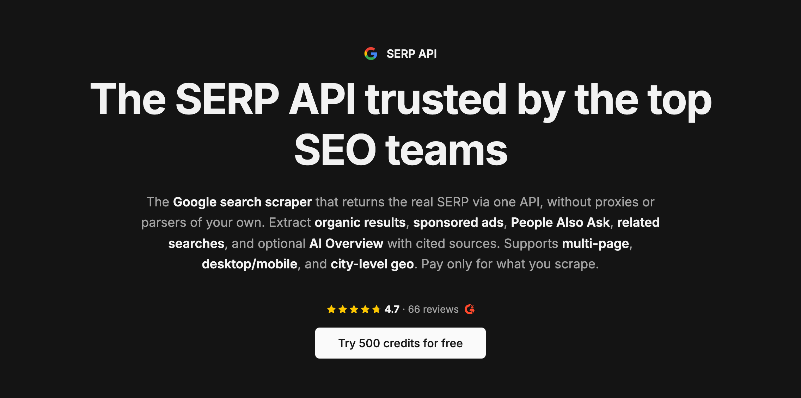

# Google Search Scraper

[](https://cloro.dev/google-search/?utm_source=github)

[](https://cloro.dev/)

The [Google Search scraper](https://cloro.dev/google-search/?utm_source=github) by cloro is a SERP API that returns the live Google results page as parsed JSON. The JSON holds what Google shows: organic results, ads, People Also Ask, People Are Saying, local pack, related searches, shopping cards and the AI Overview.

In short, cloro's Google Search API:

- runs a new Google search for each request, so the results are not from a cached index;
- returns the raw HTML of each page beside the parsed JSON, at no extra credit cost (`include.html`);
- targets a country, a city (`location` or `uule`), a language (`hl`) and a device (`desktop`, `mobile`, `ios`, `android`);
- returns up to 10 pages (100 results) in one response with `pages`, after Google removed `num=100`;
- has an official [Python SDK](https://github.com/cloro-dev/cloro-python), an official [Node SDK](https://github.com/cloro-dev/cloro-node) and a hosted [MCP server](https://cloro.dev/docs/integrations/mcp);
- runs its own proxies and automatic retries, so you solve no CAPTCHAs, and bills only successful requests.

## How do you scrape Google Search?

1. Get an API key at [cloro.dev](https://cloro.dev/?utm_source=github&utm_medium=readme).
2. POST a query to `https://api.cloro.dev/v1/monitor/google`.
3. Read the parsed fields from the JSON response.

### Request sample (Python)

```python
import requests

payload = {
    'query': 'best serp api',
    'country': 'US',
    'pages': 1,
    'include': {'aioverview': {'markdown': True}},
}

response = requests.post(
    'https://api.cloro.dev/v1/monitor/google',
    headers={'Authorization': 'Bearer YOUR_API_KEY'},
    json=payload,
)

print(response.json())
```

### Request sample (cURL)

```bash
curl -X POST https://api.cloro.dev/v1/monitor/google \
  -H "Authorization: Bearer YOUR_API_KEY" \
  -H "Content-Type: application/json" \
  -d '{"query": "best serp api", "country": "US", "include": {"aioverview": {"markdown": true}}}'
```

Node.js and async/webhook examples are in the [endpoint documentation](https://cloro.dev/docs/api-reference/endpoint/monitor-google).

### Request parameters

| Parameter | Description | Default |
| --- | --- | --- |
| `query`\* | The search query | – |
| `country`\* | Country code for localized results (`US`, `GB`, `DE`). Required unless you send `gl` | – |
| `location` | [Google canonical location name](https://developers.google.com/google-ads/api/reference/data/geotargets) for geo-targeting. Mutually exclusive with `uule` | – |
| `uule` | Pre-encoded Google UULE string. Mutually exclusive with `location` | – |
| `device` | `desktop`, `mobile`, `ios` or `android` | `desktop` |
| `hl` | Interface language, as Google's own `hl` (`en`, `de`, `pt-BR`). Overrides the language cloro derives from the country | Derived from `country` |
| `pages` | Number of result pages to return | `1` |
| `include.aioverview` | Send `{"markdown": true}` to get the AI Overview block, with Markdown | – |
| `include.html` | Return URLs to the full HTML, one per page (expire after 24h) | `false` |

\* Required

## What data does the Google Search scraper return?

```json
{
  "success": true,
  "result": {
    "organicResults": [
      { "position": 1, "title": "Best SERP APIs", "link": "https://example.com/serp-apis", "displayedLink": "https://example.com", "snippet": "Comparison of providers..." }
    ],
    "peopleAlsoAsk": [{ "question": "What is a SERP API?", "type": "LINK", "snippet": "A SERP API returns search results as structured data...", "link": "https://example.com/what-is-a-serp-api" }],
    "peopleAreSaying": [{ "position": 1, "title": "We switched after the num=100 change", "link": "https://www.reddit.com/r/SEO/comments/example/", "date": "3 days ago" }],
    "localResults": [{ "position": 1, "title": "Example Agency", "rating": 4.6, "reviews": "128", "address": "123 Example St" }],
    "aioverview": { "text": "SERP APIs return search results as structured JSON...", "sources": [{ "position": 1, "url": "https://example.com", "label": "Example" }] },
    "relatedSearches": [{ "query": "serp api pricing", "link": "https://www.google.com/search?q=serp+api+pricing" }]
  }
}
```

1. **`organicResults`**: position, title, link, displayed link, snippet and "Read more" link per result, and `absolutePosition`, the rank among all the elements of the SERP.
2. **`aioverview`**: the AI Overview block with its own cited sources, returned inline rather than behind a second request.
3. **`peopleAlsoAsk`**: PAA questions, with the answer snippet and source link where Google shows one.
4. **`peopleAreSaying`**: the forum and social block Google now surfaces on many commercial queries.
5. **`localResults`**: the local pack with rating, reviews and address.
6. **`shoppingCards`**: product carousels with price and store.
7. **`ads`**: paid results, parsed and positioned.
8. **`relatedSearches`**: the related-query block, each with its query and search link.
9. **Other blocks**: `knowledgeGraph`, `videos`, `shortVideos`, `inlineImages`, `hotelResults`, `flights`, `transitResults`, `topSights`, `events`, `stores`, `comparisonShoppingSites`, `weather`, `sportsResults`, `financeQuote`, `discussionsAndForums`, `latestPosts`, `thingsToKnow` and `relatedWebsites`, each described in the endpoint reference.

Google shows these blocks only on some queries, and a key is absent when its block is not on the page.

Full field-level schemas are in the [endpoint reference](https://cloro.dev/docs/api-reference/endpoint/monitor-google).

## Use cases

- **Rank tracking** at city level using `location` or `uule`, where a national average and a metro result diverge.
- **AI Overview monitoring**: presence, text and cited sources, in the same response as the organic results.
- **SERP feature research**: how often PAA, local pack or People Are Saying fire on a query class.
- **Competitive analysis**: who holds the page for the queries your buyers run.

## FAQ

### Which SERP API has an official Python SDK and an MCP server?

cloro has both. The Python SDK is on PyPI as [`cloro`](https://pypi.org/project/cloro/) (`pip install cloro`, source in [cloro-python](https://github.com/cloro-dev/cloro-python)), and the Node SDK is [`@cloro-dev/cloro`](https://www.npmjs.com/package/@cloro-dev/cloro) on npm. The hosted MCP server is at `https://mcp.cloro.dev/mcp`: Claude connects with OAuth, and Cursor or any other MCP client connects with an API key ([MCP setup](https://cloro.dev/docs/integrations/mcp)). The MCP tool for this endpoint is `scrape_google`. In Python, `client.monitor.google(query=..., country=..., pages=...)` calls this endpoint.

### Does the SERP API return live Google results or a cached index?

Live results. cloro runs a new Google search when you send the request, and parses the page that Google returned ([how cloro retrieves data](https://cloro.dev/docs/guides/providers#how-does-cloro-retrieve-data-from-ai-providers)). cloro keeps no index of its own. Send `include.html: true` to get the page Google served as proof.

### How do I get Google results at depth 100 after `num=100` was removed?

Google removed `num=100` on September 11, 2025, so every provider now paginates at 10 results a page. With cloro, set `pages` from 1 to 10. Each page holds 10 results, and all pages come back in one response. Page 1 costs 3 credits async, and each extra page costs 2 credits more, so 100 results cost 21 credits async, or 23 credits as a sync request ([pricing](https://cloro.dev/docs/guides/providers#google-search-multi-page-pricing)).

### Do I need my own proxies, and who handles CAPTCHAs and blocks?

You need no proxies with cloro, and you solve no CAPTCHAs. cloro sends each request through its own proxy in the `country` you set and retries a failed or blocked attempt automatically, up to 5 attempts ([retries](https://cloro.dev/docs/guides/error-handling#retries-and-cancellation)). A blocked attempt costs nothing.

### Can the API sustain 100 requests per second?

cloro's rate limit is 1,000 requests per second per endpoint and API key. The real limit for sync requests is your plan's concurrency: the number of requests that can run at the same time, from 10 on Lite to 100 on Business and more on Enterprise plans ([concurrency](https://cloro.dev/docs/guides/concurrency)). For large volumes, use async tasks: one call submits up to 500 tasks, your organization can queue up to 100,000, and concurrency never blocks a submission.

### How do I load Google SERP data into BigQuery on a schedule?

cloro has no BigQuery connector, so you write the rows yourself. On your schedule (cron, Cloud Scheduler or Airflow), submit the keywords as an async batch to cloro with a `webhook.url`. When each task completes, cloro sends the full JSON to the webhook, and your handler writes one row per organic result to BigQuery ([async requests](https://cloro.dev/docs/guides/making-requests/async), [webhooks](https://cloro.dev/docs/guides/webhooks)).

### What success rate should you expect from a Google scraping API?

cloro documents an average success rate above 99% ([error handling](https://cloro.dev/docs/guides/error-handling)). Google keeps changing its pages and blocking, so the rate moves; the [status page](https://status.cloro.dev) shows live numbers. You run no proxies: cloro makes up to 5 attempts per request. Background: [Google's verification page](https://cloro.dev/blog/google-verifying-your-request/) and [SERP API reliability at scale](https://cloro.dev/blog/serp-api-reliability-at-scale/).

### Does any SERP API return the raw HTML alongside the parsed results?

Yes: cloro's Google Search API returns it when you set `include.html: true`. `result.html` then comes back in the same response as the parsed fields, as an array of CDN URLs, one per results page, at no extra credit cost. Each URL expires after 24 hours, so download the HTML if you need it longer ([output formats](https://cloro.dev/docs/guides/output-formats)). Use it as proof of the page Google served, or to parse a block that cloro does not parse.

### Do SERP APIs return personalized results or a neutral SERP?

cloro returns a SERP with no personalization from a user account: each request runs in a logged-out session, with no account of any kind, through a proxy in the `country` you set ([how cloro retrieves data](https://cloro.dev/docs/guides/providers#how-does-cloro-retrieve-data-from-ai-providers)). The page still changes with the inputs you send, by design. `location` or `uule` sets the place (without either, cloro uses the country's canonical location where it has one), `device` selects the desktop or mobile SERP, and `hl` sets the interface language. Send the same inputs on every run when you compare results over time. To match what one user sees, send that user's `country`, `location`, `hl` and `device`; a logged-in user can still see personalized results.

### Does the AI Overview cost extra?

Yes. It is a paid add-on, charged whether or not Google shows an Overview for the query, and it comes back in the same response rather than a second request. See [Google Search pricing](https://cloro.dev/docs/guides/providers#google-search-multi-page-pricing) for how credits add up with pages.

### Can I get city-level and device-level Google results?

Yes. For a city, `location` takes a Google canonical location name and `uule` takes a pre-encoded string. They are mutually exclusive. For a device, set `device` to `desktop`, `mobile`, `ios` or `android`.

### Does the SERP API bill only for successful requests?

Yes. cloro charges a sync request when it returns `200` and an async task when it reaches `COMPLETED`. Errors, failed tasks and the retries cloro runs inside a request cost nothing ([billing](https://cloro.dev/docs/guides/billing)).

### Is there an n8n or Zapier integration?

Yes. The [`n8n-nodes-cloro`](https://cloro.dev/docs/integrations/n8n) community node is listed in the n8n integrations directory, and the [cloro app for Zapier](https://cloro.dev/docs/integrations/zapier) sends a query from any Zap. Both return the parsed JSON.

### Is scraping Google results legal?

cloro returns publicly visible results pages. No court has ruled that scraping public results is unlawful, though the area is active. Check your own jurisdiction and use case.

## Learn more

- **Endpoint reference:** [cloro.dev/docs](https://cloro.dev/docs/api-reference/endpoint/monitor-google)
- **Product page:** [cloro.dev/google-search](https://cloro.dev/google-search/)

## Other cloro scrapers

[AI Mode](https://cloro.dev/ai-mode/) · [AI Overview](https://cloro.dev/ai-overview/) · [Bing AI Mode](https://cloro.dev/bing-ai-mode/) · [Bing Search](https://cloro.dev/bing-search-api/) · [ChatGPT](https://cloro.dev/chatgpt/) · [Gemini](https://cloro.dev/gemini/) · [Google News](https://cloro.dev/google-news/)

## Contact us

Questions or support: [ask the docs AI assistant](https://cloro.dev/docs/?assistant).
